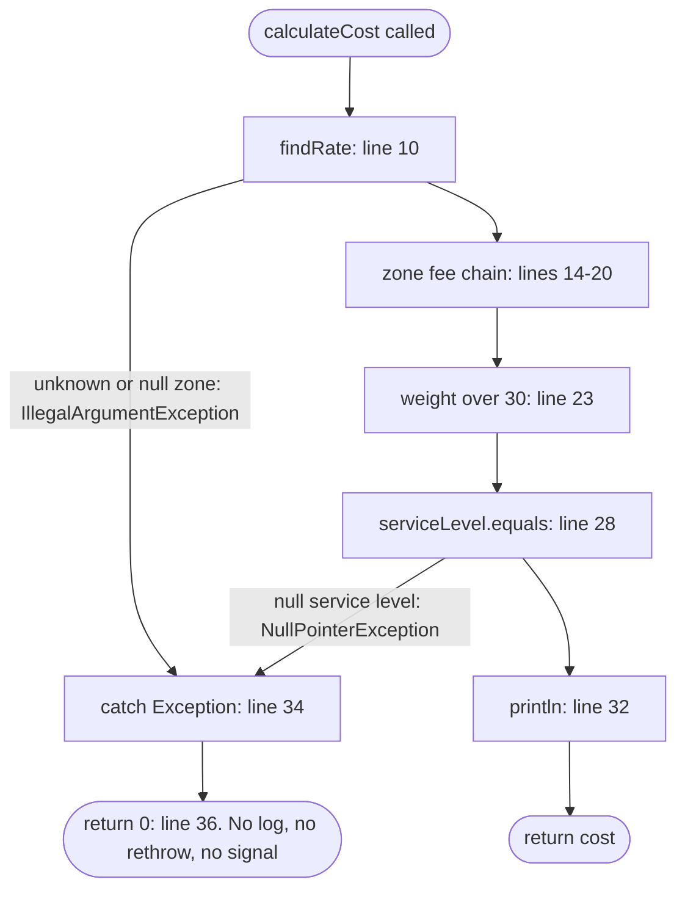
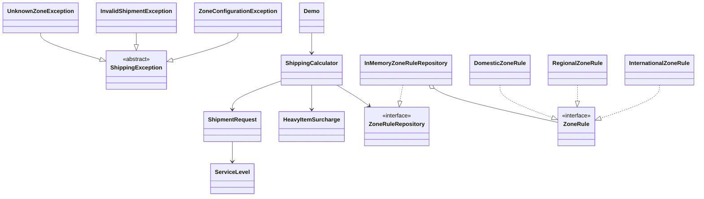
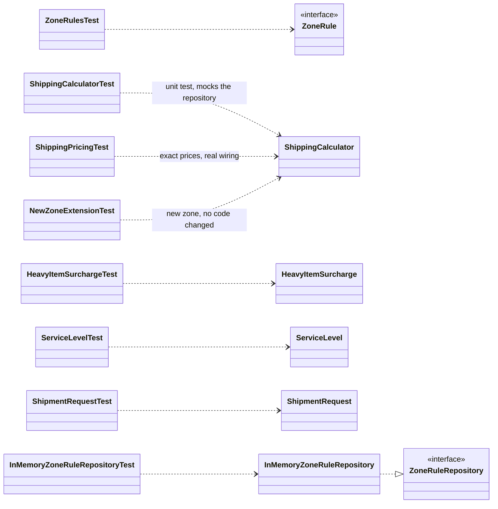

# Analysis: Tidewater Freight Shipping Cost Service

This document analyses the Tidewater Freight shipping cost service. It identifies the problems in the starter code, ranks them by business impact, and shows which of the existing tests prove nothing. Line references are links to the starter repository, and every claim was reproduced against the original code.

## The most serious problem

**The calculator catches every exception and returns a price of 0** ([`ShippingCalculator` #L9](https://github.com/isaiah-lartey/Code-Quality-Testing-Lab-1/blob/10cb1a3/src/main/java/com/tidewater/freight/ShippingCalculator.java#L9) and [#L34-L37](https://github.com/isaiah-lartey/Code-Quality-Testing-Lab-1/blob/10cb1a3/src/main/java/com/tidewater/freight/ShippingCalculator.java#L34-L37)).

An unknown zone, a null input, or a bug in the calculation all come back as `0.0`, so the company ships for free and nobody is told. It is a swallowed exception: the caller is told the operation succeeded when it failed. The repository throws a clear error for an unknown zone on purpose ([`InMemoryRateRepository` 20](https://github.com/isaiah-lartey/Code-Quality-Testing-Lab-1/blob/10cb1a3/src/main/java/com/tidewater/freight/InMemoryRateRepository.java#L20)), and the calculator throws it away.

This ranks first because it is silent and it loses money directly. It is also why `Demo` looks fine: [line 9 of `Demo`](https://github.com/isaiah-lartey/Code-Quality-Testing-Lab-1/blob/10cb1a3/src/main/java/com/tidewater/freight/Demo.java#L9) asks for the zone `MOON` and prints `0.0` as if that were a price.



## Problems in the code, ranked by business impact

| # | Problem | Principle | Where | Business risk |
|---|---|---|---|---|
| 1 | Every failure becomes a price of 0 | Swallowed exception | [`ShippingCalculator` 9, 34–37](https://github.com/isaiah-lartey/Code-Quality-Testing-Lab-1/blob/10cb1a3/src/main/java/com/tidewater/freight/ShippingCalculator.java#L34-L37) | Silent revenue loss: any unknown zone or bug ships for free, with no alert to operations. |
| 2 | No input validation: negative, NaN and infinite weights, and mistyped service levels, are priced | Failures must surface | [`ShippingCalculator` 8, 23, 28](https://github.com/isaiah-lartey/Code-Quality-Testing-Lab-1/blob/10cb1a3/src/main/java/com/tidewater/freight/ShippingCalculator.java#L8) | Revenue leakage and customer disputes: negative weights produce negative prices the company must honour; a typo in `EXPRESS` is silently charged as `STANDARD`. |
| 3 | A new zone means editing the calculator, and forgetting to gives no fee and no error | Open-closed principle | [`ShippingCalculator` 14–20](https://github.com/isaiah-lartey/Code-Quality-Testing-Lab-1/blob/10cb1a3/src/main/java/com/tidewater/freight/ShippingCalculator.java#L14-L20); [`InMemoryRateRepository` 11–13](https://github.com/isaiah-lartey/Code-Quality-Testing-Lab-1/blob/10cb1a3/src/main/java/com/tidewater/freight/InMemoryRateRepository.java#L11-L13) | Shipping cost set incorrectly for every new zone; the "coming rule change" is exactly this case. |
| 4 | The calculator builds its own repository | Dependency inversion principle | [`ShippingCalculator` 5–6](https://github.com/isaiah-lartey/Code-Quality-Testing-Lab-1/blob/10cb1a3/src/main/java/com/tidewater/freight/ShippingCalculator.java#L5-L6) | Cannot test or replace the rate source; a wrong price cannot be caught before it reaches a customer. |
| 5 | One method with six jobs | Single-responsibility principle; small methods that do one thing | [`ShippingCalculator` 8–38](https://github.com/isaiah-lartey/Code-Quality-Testing-Lab-1/blob/10cb1a3/src/main/java/com/tidewater/freight/ShippingCalculator.java#L8-L38) | Every rule change touches the same method; a regression in pricing, output or error handling is one edit away. |
| 6 | Money calculated in `double` | Correctness | [`ShippingCalculator` 10–11](https://github.com/isaiah-lartey/Code-Quality-Testing-Lab-1/blob/10cb1a3/src/main/java/com/tidewater/freight/ShippingCalculator.java#L10-L11); [`InMemoryRateRepository` 8](https://github.com/isaiah-lartey/Code-Quality-Testing-Lab-1/blob/10cb1a3/src/main/java/com/tidewater/freight/InMemoryRateRepository.java#L8) | ~31% of prices are off by a fraction of a cent; summed invoices will not balance against a calculator. |
| 7 | Printing inside the calculation | Side effects | [`ShippingCalculator` 32](https://github.com/isaiah-lartey/Code-Quality-Testing-Lab-1/blob/10cb1a3/src/main/java/com/tidewater/freight/ShippingCalculator.java#L32) | Output is coupled to pricing and cannot be tested; production logs and customer-facing receipts drift apart. |
| 8 | Business numbers have no names | Magic numbers | [`ShippingCalculator` 17, 19, 23, 24, 29](https://github.com/isaiah-lartey/Code-Quality-Testing-Lab-1/blob/10cb1a3/src/main/java/com/tidewater/freight/ShippingCalculator.java#L17-L29) | A rate change is a hunt-and-edit; there is no single source of truth for the surcharge, fee or multiplier. |
| 9 | Strings choose behaviour, and the method takes three arguments | Few arguments; no selector parameters | [`ShippingCalculator` 8, 14–18, 28](https://github.com/isaiah-lartey/Code-Quality-Testing-Lab-1/blob/10cb1a3/src/main/java/com/tidewater/freight/ShippingCalculator.java#L8) | A typo compiles and ships at the wrong price, and no compiler or test can catch it. |
| 10 | The unknown-zone failure is a generic exception type | Specific exceptions | [`InMemoryRateRepository` 20](https://github.com/isaiah-lartey/Code-Quality-Testing-Lab-1/blob/10cb1a3/src/main/java/com/tidewater/freight/InMemoryRateRepository.java#L20) | Callers cannot tell an unknown zone from a bad weight; any `catch` handles both the same way. |
| 11 | A mutable `HashMap` holds what are really constants | Shared mutable state | [`InMemoryRateRepository` 8, 11–13](https://github.com/isaiah-lartey/Code-Quality-Testing-Lab-1/blob/10cb1a3/src/main/java/com/tidewater/freight/InMemoryRateRepository.java#L8-L13) | Rates can be changed by any caller that has the map; pricing is no longer deterministic. |
| 12 | Comments that restate code or excuse a design, and an empty `if` branch | Noise comments | [`ShippingCalculator` 5, 13, 14–15, 17, 19, 22, 27, 35](https://github.com/isaiah-lartey/Code-Quality-Testing-Lab-1/blob/10cb1a3/src/main/java/com/tidewater/freight/ShippingCalculator.java#L5-L35) | Comments and the empty branch hide a logic gap that a reader is told not to worry about. |
| 13 | Lines over 100 columns, and wildcard imports in the test | Formatting and imports | [`Demo` 7–9](https://github.com/isaiah-lartey/Code-Quality-Testing-Lab-1/blob/10cb1a3/src/main/java/com/tidewater/freight/Demo.java#L7-L9); [`ShippingCalculator` 32](https://github.com/isaiah-lartey/Code-Quality-Testing-Lab-1/blob/10cb1a3/src/main/java/com/tidewater/freight/ShippingCalculator.java#L32); [test 5–6](src/test/java/com/tidewater/freight/ShippingCalculatorTest.java#L5-L6) | Slower reviews; wildcard imports make it unclear which type a test actually depends on. |

### 2. No input validation
Bad weights do not throw. They return a wrong price straight away. A mistyped service level is silently charged as standard ([`ShippingCalculator` 8, 23, 28](https://github.com/isaiah-lartey/Code-Quality-Testing-Lab-1/blob/10cb1a3/src/main/java/com/tidewater/freight/ShippingCalculator.java#L8)). Zero weight returns `0.0`; nobody decided that should be allowed. **Business risk:** a negative weight is priced as a negative cost the company is obliged to honour; a lowercase `express` is billed as `STANDARD`.

### 3. A new zone means editing existing code
The fees are an `if / else if` chain keyed on the zone name ([`ShippingCalculator` 14–20](https://github.com/isaiah-lartey/Code-Quality-Testing-Lab-1/blob/10cb1a3/src/main/java/com/tidewater/freight/ShippingCalculator.java#L14-L20)). Every new zone means editing it, and the chain has no `else`: a zone with no entry gets no fee and no error. Adding only a rate for a new zone, `ARCTIC`, to the repository still ships it at the base rate with no handling fee and no warning. This is the change Tidewater says is coming, so it is the first thing the new zone would hit. **Business risk:** the new shipping lane launches at a price that is quietly wrong, and nothing on the dashboard shows it.

### 4. The calculator builds its own repository
`RateRepository` exists ([`ShippingCalculator` 5–6](https://github.com/isaiah-lartey/Code-Quality-Testing-Lab-1/blob/10cb1a3/src/main/java/com/tidewater/freight/ShippingCalculator.java#L5-L6)), but the field initialiser on line 6 makes it pointless. Handing the calculator another rate source does not compile, because the constructor takes no arguments. This is also why the tests are weak (see *([`ShippingCalculatorTest.java`](src/test/java/com/tidewater/freight/ShippingCalculatorTest.java)) that prove nothing*): they cannot control the rates. **Business risk:** a pricing error cannot be caught by a test before it reaches an invoice, because the rate source cannot be replaced.

### 5. One method with six jobs
`calculateCost` spans lines 8–38, 31 lines. It looks up a rate, applies zone fees, applies the heavy surcharge, applies the express multiplier, prints, and decides the error policy. The class has one reason to change for each of those. **Business risk:** every rule change is a single-method edit, and the last edit is the one that breaks the invoice.

### 6. Money calculated in `double`
Prices are computed with `double` arithmetic ([`ShippingCalculator` 10–11](https://github.com/isaiah-lartey/Code-Quality-Testing-Lab-1/blob/10cb1a3/src/main/java/com/tidewater/freight/ShippingCalculator.java#L10-L11); [`InMemoryRateRepository` 8](https://github.com/isaiah-lartey/Code-Quality-Testing-Lab-1/blob/10cb1a3/src/main/java/com/tidewater/freight/InMemoryRateRepository.java#L8)). `double` cannot represent most decimal fractions exactly — `0.1 + 0.2` is `0.30000000000000004`, not `0.3` — so a price that passes through `rate * weight` can be off by a fraction of a cent. **Business risk:** a price that is summed, compared, or rounded by a second system will not match the value this service returns; equality checks on prices become unreliable, and reconciliation of statements against a calculator becomes a manual fix. The fix is `BigDecimal`, which represents decimal values exactly.

### 7. Printing inside the calculation
Line 32 writes to the console from inside a pricing method. Output is a different concern from pricing, it cannot be asserted in a test, and it only runs on success. The line is also 112 columns. **Business risk:** the pricing method cannot be exercised in a test without capturing stdout, so the output path is untested.

### 8. Magic numbers, and an unwritten rule in the ordering
The values on lines 17, 19, 23, 24 and 29 are `10`, `25`, `30`, `20` and `1.5`, with no names. The heavy surcharge is added before the express multiplier, so express multiplies the surcharge. That may be intended, but nothing states it and no test pins it. **Business risk:** a rate change is a hunt-and-edit; the ordering rule is invisible and is not pinned by a test, so a future refactor can flip it silently.

### 9. Strings choose behaviour
`calculateCost(zone, weightKg, serviceLevel)` takes three arguments, and the two strings are what select the behaviour (lines 14–18 and 28). Because they are plain strings, a typo compiles and runs (see problem 2). The three arguments are also a candidate for one request object. **Business risk:** the compiler cannot catch a misspelt service level; it is priced as `STANDARD` and no one is told.

### 10. Generic exception for an unknown zone
`IllegalArgumentException` ([`InMemoryRateRepository` 20](https://github.com/isaiah-lartey/Code-Quality-Testing-Lab-1/blob/10cb1a3/src/main/java/com/tidewater/freight/InMemoryRateRepository.java#L20)) carries a message but cannot be told apart from any other bad argument without parsing text. A specific exception type adds clarity. **Business risk:** a caller cannot distinguish an unknown zone from a bad weight, so the two are handled the same way.


## Tests that prove nothing

| Test | Lines | Why it proves nothing | Business risk |
|---|---|---|---|
| `calculatesExpressCost` | [17–23](src/test/java/com/tidewater/freight/ShippingCalculatorTest.java#L17-L23) | Creates a **mock of the class under test** (line 20), stubs it with `thenReturn(967.5)` (line 21), then asserts it returns 967.5 (line 22). The real calculator never runs, so it tests Mockito, not the pricing. It would still pass if the calculator's logic were deleted. | The green build is read as "pricing works"; nothing in it exercises the real calculator. |
| `returnsACostForAShipment` | [25–30](src/test/java/com/tidewater/freight/ShippingCalculatorTest.java#L25-L30) | `assertNotNull` on a primitive `double` (line 29). It is boxed on the way in and can never be null, so the assertion cannot fail. | A green build cannot distinguish a working price from a broken one. |
| `calculatesACost` | [10–15](src/test/java/com/tidewater/freight/ShippingCalculatorTest.java#L10-L15) | `assertTrue(cost > 0)` (line 14) passes for `0.01` and `50000` alike. It does not check the price. | The suite cannot catch a wrong price; the amount on the invoice is unpinned. |

The 967.5 in the mocked test is the correct price for `INTERNATIONAL 40kg EXPRESS`. The author knew the right answer and never asked the real code for it.

### Names and isolation
`calculatesACost` and `returnsACostForAShipment` do not say what behaviour is checked. Because the calculator builds its own repository (problem 4), no test can supply its own rates, so every test depends on the numbers hard-coded in `InMemoryRateRepository`. **Business risk:** a green build is taken as evidence of correctness, but the suite cannot catch a regression in any of the pricing rules the company actually sells.


## Planned Refactor structure

```
https://github.com/isaiah-lartey/Code-Quality-Testing-Lab-1/blob/10cb1a3/src/main/java/com/tidewater/freight/
  ShippingCalculator.java
  ShipmentRequest.java
  ServiceLevel.java
  HeavyItemSurcharge.java
  ZoneRule.java
  DomesticZoneRule.java
  RegionalZoneRule.java
  InternationalZoneRule.java
  ZoneRuleRepository.java
  InMemoryZoneRuleRepository.java
  ShippingException.java
  UnknownZoneException.java
  InvalidShipmentException.java
  ZoneConfigurationException.java
  Demo.java

src/test/java/com/tidewater/freight/
  ShippingCalculatorTest.java
  ShippingPricingTest.java
  ZoneRulesTest.java
  HeavyItemSurchargeTest.java
  ServiceLevelTest.java
  ShipmentRequestTest.java
  InMemoryZoneRuleRepositoryTest.java
  NewZoneExtensionTest.java
```

### Production classes



### Test classes

